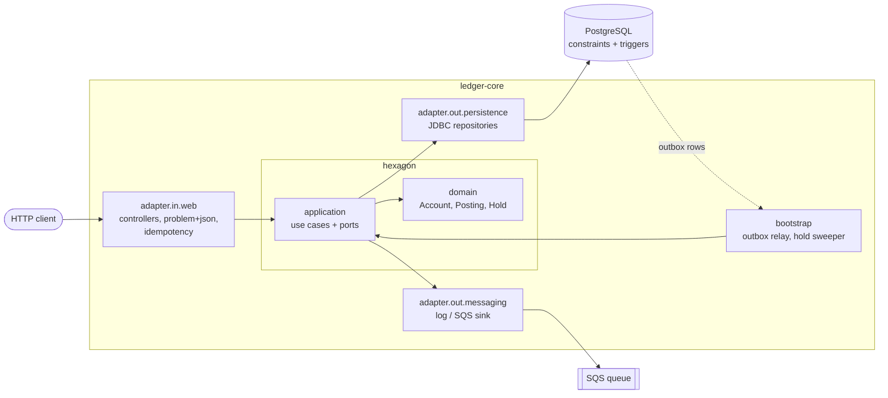

# ledger-core

**English** | [Português (Brasil)](README.pt-BR.md)

[](https://github.com/FrancisWorld/ledger-core/actions/workflows/ci.yml)
[](LICENSE)

A double-entry accounting ledger API in Java 21 and Spring Boot. Money is moved only as balanced journal entries, and the rules that keep the books honest are enforced twice: in the domain model and again inside PostgreSQL.

## Why it exists, and what is hard about it

A ledger looks like "update two balances" until concurrency, retries and crashes show up. This project is a worked answer to the usual failure modes:

| Problem | How it is handled |
| --- | --- |
| Two requests spend the same money | Rows are locked with `SELECT ... FOR UPDATE`, always in ascending account-id order, so concurrent transfers serialize per account and cannot deadlock. A `CHECK` constraint backs the overdraft rule in the database. |
| Client retries a timed-out request | `Idempotency-Key` on every `POST`. The key row and the business writes commit in one transaction, so a retry replays the stored response and money moves once. Same key with a different body is `409`. |
| Someone edits history | `entries` and `transactions` are append-only (triggers reject `UPDATE`, `DELETE` and `TRUNCATE`), and a deferred constraint trigger refuses to commit a transaction whose debits and credits differ per currency. The service also connects as a database role with no such privileges at all and cannot drop or disable the triggers, so a compromised service cannot rewrite the journal. |
| Who may call what | Bearer API keys, stored as SHA-256 digests, each endpoint requiring one scope (closed by default; ArchUnit fails the build if an endpoint forgets to declare one). Idempotency keys are namespaced per API key. |
| Publishing an event and committing data can disagree | Transactional outbox: events are written in the same transaction as the change and relayed with `FOR UPDATE SKIP LOCKED`, at-least-once. |
| Card-style authorizations | Holds reserve funds (`available = balance - held`), can be captured (fully or partially) or released, and expire automatically. |
| Mistakes | Reversals post a new, mirrored transaction; a transaction can be reversed once and the database enforces that with a unique index. |

Amounts are integer minor units plus an ISO 4217 currency. There are no floats or decimals anywhere.

## Architecture



`domain` and `application` are plain Java with no framework imports. ArchUnit rules in `ArchitectureTest` fail the build if a dependency points the wrong way (for example the application importing Spring or JDBC, or the web layer touching SQL).

## Quickstart

Requirements: JDK 21 and Docker.

```bash
cp .env.example .env                  # placeholder passwords, change them
docker compose up --build -d          # postgres, a one-shot migration job, then the service
```

Compose runs three things: PostgreSQL, a `migrate` job that applies the Flyway migrations as the schema owner and exits, and the service, which connects as the unprivileged `ledger_app` role (no DDL, no UPDATE/DELETE on the journal, cannot touch the triggers). The service listens on `http://localhost:8080`; health and metrics are on the internal management port 8081 and are not exposed by compose.

Every `/v1` endpoint needs an API key (`Authorization: Bearer ...`) whose scopes cover the operation. Keys are issued by the owner-level `keygen` job, printed once and stored only as a SHA-256 digest. The whole flow below (accounts, funding, transfer, idempotent replay, hold and capture, statement, integrity check) was run against this compose stack; the output follows it. I ran it with `LEDGER_HTTP_PORT=18080` to avoid a port clash on my machine; the commands use the default 8080.

```bash
export API=http://localhost:8080
export KEY=$(docker compose run --rm keygen 2>/dev/null | sed -n 's/^API_KEY=//p')
post() { curl -s -X POST "$API$1" -H "Authorization: Bearer $KEY" -H "Content-Type: application/json" -H "Idempotency-Key: $2" -d "$3"; }
get() { curl -s "$API$1" -H "Authorization: Bearer $KEY"; }

CASH=$(post /v1/accounts quick-cash '{"code":"cash","name":"Cash","type":"ASSET","currency":"USD","allow_negative":true}' | jq -r .id)
ALICE=$(post /v1/accounts quick-alice '{"code":"alice","name":"Alice wallet","type":"LIABILITY","currency":"USD"}' | jq -r .id)
BOB=$(post /v1/accounts quick-bob '{"code":"bob","name":"Bob wallet","type":"LIABILITY","currency":"USD"}' | jq -r .id)
echo "cash=$CASH alice=$ALICE bob=$BOB"

# fund Alice with 100.00 USD: debit cash, credit her wallet
post /v1/transactions quick-fund "{\"reference\":\"top-up\",\"lines\":[{\"account_id\":\"$CASH\",\"direction\":\"DEBIT\",\"amount\":10000},{\"account_id\":\"$ALICE\",\"direction\":\"CREDIT\",\"amount\":10000}]}" | jq -c '{kind, entries: [.entries[] | {direction, amount, balance_after}]}'

# transfer 25.00 to Bob; repeating the request replays the stored response
post /v1/transfers quick-t1 "{\"source_account_id\":\"$ALICE\",\"destination_account_id\":\"$BOB\",\"amount\":2500,\"currency\":\"USD\"}" | jq -c '{kind, entries: [.entries[] | {direction, amount, balance_after}]}'
curl -si -X POST "$API/v1/transfers" -H "Authorization: Bearer $KEY" -H "Content-Type: application/json" -H "Idempotency-Key: quick-t1" -d "{\"source_account_id\":\"$ALICE\",\"destination_account_id\":\"$BOB\",\"amount\":2500,\"currency\":\"USD\"}" | grep -iE '^(HTTP|idempotent-replayed)'

# reserve 30.00 on Alice, then capture 20.00 of it to Bob
HOLD=$(post /v1/holds quick-hold "{\"account_id\":\"$ALICE\",\"amount\":3000,\"currency\":\"USD\",\"reference\":\"order-1\"}" | jq -r .id)
get /v1/accounts/$ALICE | jq -c '{balance, held, available}'
post /v1/holds/$HOLD/capture quick-capture "{\"destination_account_id\":\"$BOB\",\"amount\":2000}" | jq -c '{hold: .hold.status, captured: .hold.captured_amount}'
get /v1/accounts/$ALICE | jq -c '{balance, held, available}'

# statement: every entry with its running balance
get "/v1/accounts/$ALICE/statement?limit=10" | jq -c '.lines[] | {seq, kind, direction, amount, balance_after}'

# integrity check
get /v1/trial-balance | jq -c .

# no key, wrong scope
curl -s -o /dev/null -w "no key: %{http_code}\n" "$API/v1/trial-balance"
```

Output of that run (ids are UUIDv7; amounts are minor units, so 10000 is 100.00 USD):

```text
cash=01a2154c-1a6f-7287-bc11-49732cec0997 alice=01a2154c-1d0e-7301-9226-3f8178e2dfc4 bob=01a2154c-1e08-7505-86d0-1a68c0b44739
{"kind":"JOURNAL","entries":[{"direction":"DEBIT","amount":10000,"balance_after":10000},{"direction":"CREDIT","amount":10000,"balance_after":10000}]}
{"kind":"TRANSFER","entries":[{"direction":"DEBIT","amount":2500,"balance_after":7500},{"direction":"CREDIT","amount":2500,"balance_after":2500}]}
HTTP/1.1 201 
Idempotent-Replayed: true
{"balance":7500,"held":3000,"available":4500}
{"hold":"CAPTURED","captured":2000}
{"balance":5500,"held":0,"available":5500}
{"seq":2,"kind":"JOURNAL","direction":"CREDIT","amount":10000,"balance_after":10000}
{"seq":3,"kind":"TRANSFER","direction":"DEBIT","amount":2500,"balance_after":7500}
{"seq":5,"kind":"CAPTURE","direction":"DEBIT","amount":2000,"balance_after":5500}
{"balanced":true,"currencies":[{"currency":"USD","debit_normal_total":10000,"credit_normal_total":10000,"drifted_accounts":0,"balanced":true}]}
no key: 401
```

Swagger UI is served at `/swagger-ui` and the OpenAPI document at `/v3/api-docs` (both public; disable them with `springdoc.api-docs.enabled=false` if you do not want them exposed). Health is at `http://localhost:8081/actuator/health` inside the container network, Prometheus metrics at `:8081/actuator/prometheus`.

Scopes: `accounts:read`, `accounts:write`, `transactions:read`, `transactions:write`, `holds:read`, `holds:write`, `reports:read`. Issue a narrower key with `LEDGER_KEY_NAME=reporting LEDGER_KEY_SCOPES=reports:read docker compose run --rm keygen`.

## Design decisions and trade-offs

- **Pessimistic locking over optimistic retries.** Account rows are the contention point, and a ledger must never reject a valid transfer because someone else touched the account. Locks are taken in a total order (ascending id), which is what makes the design deadlock-free, and a transaction touches at most 100 accounts. The cost is that a very hot account serializes its writers; see Limitations.
- **Overdraft is judged on the final state of a journal**, not line by line, so the order of lines inside a transaction is irrelevant. Accounts opt out with `allow_negative` (cash, treasury, clearing accounts).
- **Account type decides the normal side.** Assets and expenses grow with debits, liabilities, equity and revenue grow with credits, so a customer wallet is a credit-normal liability and `balance` is always the natural, positive figure.
- **Every entry stores `balance_after`.** Statements need no window function, and the trial-balance endpoint can replay all entries and prove that each stored balance matches its history.
- **Idempotency lives in the same transaction as the work.** There is no "in progress" state to get stuck in after a crash. The cost: a request that fails (for example insufficient funds) leaves no key behind and is simply re-evaluated on retry. The fingerprint is a hash of the operation plus the canonical re-serialization of the parsed body, so whitespace and field order do not matter.
- **Outbox delivery is at-least-once.** A crash after the broker accepted a message but before the batch commits re-delivers it, and consumers de-duplicate on the `event_id` message attribute. Messages that keep failing back off exponentially and are finally parked as `DEAD` instead of blocking the queue.
- **Holds** are restricted to credit-normal accounts (wallets) and always need real funds: `allow_negative` lets debits overdraw an account but never lets a hold reserve money it does not have. A capture dissolves the whole reservation: the captured part becomes a debit and the rest is free again. Hold expiry locks the affected accounts in the same ascending-id order as every other writer, which is what keeps it from deadlocking against transfers.
- **Checked arithmetic everywhere.** Balances use `Math.addExact`; `available = balance - held` saturates at `Long.MIN_VALUE` instead of wrapping, with property tests at the `long` bounds.
- **Two database roles.** Flyway runs as the schema owner; the service runs as `ledger_app` (DML on the operational tables, `SELECT`/`INSERT` only on the journal, read-only on `api_keys`). Because the runtime role has no `UPDATE` privilege on `transactions`, reversals serialize with a transaction-scoped advisory lock instead of `SELECT ... FOR UPDATE`. In AWS a one-off migrate task holds the master secret and the service only ever sees the `ledger_app` secret.
- **Plain JDBC (`JdbcClient`) instead of JPA.** The interesting behaviour is the SQL, so it is written and tested as SQL.
- **UUIDv7 identifiers** keep primary-key inserts roughly time-ordered.

## Testing strategy

`./mvnw verify` runs everything. Integration tests start PostgreSQL 16 with Testcontainers.

| Layer | What it proves |
| --- | --- |
| Domain unit tests | Normal sides, balance maths, overflow, hold state machine, journal validation. |
| jqwik properties | Over random worlds and journals: the accounting equation always holds, accepted journals never overdraw a wallet, line order never changes the outcome, a reversal restores every balance, running balances match final state. |
| `RuntimeRoleIT` | A raw connection as the runtime role: it cannot UPDATE, DELETE or TRUNCATE journal rows, cannot disable or drop the triggers, cannot `SET session_replication_role`, run DDL or issue API keys. |
| `AuthenticationIT` | 401 without or with unknown, malformed or revoked keys, 403 for missing scopes (reads do not grant writes), idempotency keys isolated per client, keys stored hashed, health and metrics only on the management port. |
| `DatabaseInvariantsIT` | Raw SQL as the schema owner that bypasses the application: unbalanced entries fail at commit, history cannot be updated, deleted or truncated, accounts cannot overdraw, entries must match their account currency. |
| `LedgerApiIT` | End-to-end HTTP behaviour, `application/problem+json` shapes, statements and pagination, holds, reversals, OpenAPI and metrics. |
| `IdempotencyIT` | Replays, key reuse conflicts, canonical fingerprints, retry after failure, and 24 concurrent duplicates executing exactly once. |
| `ConcurrencyIT` | Hold expiry racing with transfers (no deadlock), and a mixed transfer / hold / capture / release / reversal workload from many threads, then an audit: money is conserved, nothing is overdrawn, held funds equal active holds, every account's running-balance chain is unbroken, the trial balance is balanced. Also opposing transfers (no deadlock), contended spending and holds (never overdrawn), racing reversals (exactly one wins). |
| `OutboxIT` | Events commit atomically with their change, four concurrent relays deliver each message once, a simulated crash after delivery re-delivers instead of losing, poison messages back off and are parked. |
| `ArchitectureTest` | The hexagonal dependency rules. |

A correctness workload, not a benchmark: `ConcurrencyIT` runs 24 threads x 120 mixed operations (transfers, holds, captures, releases, reversals) over 12 wallets; in my last run 2452 operations succeeded and 428 were legitimately rejected (insufficient funds, hold already settled, already reversed), taking about 14 s, after which every invariant audit passed. Measured on an Apple Silicon laptop (M1, 8 GB) with PostgreSQL running in a Colima VM with `fsync=off`, so the throughput says nothing about production capacity.

Run the integration tests without Testcontainers by pointing them at any PostgreSQL 16 (for example the compose one) with `LEDGER_TEST_DB_URL`, `LEDGER_TEST_DB_USER` and `LEDGER_TEST_DB_PASSWORD`. On Colima, Testcontainers needs `DOCKER_HOST=unix://$HOME/.colima/default/docker.sock` and `TESTCONTAINERS_DOCKER_SOCKET_OVERRIDE=/var/run/docker.sock`.

Code style is gated by Spotless (google-java-format) and Checkstyle, both bound to the `validate` phase; run `./mvnw spotless:apply` to format. The compiler runs with `-Xlint:all -Werror`.

## Infrastructure

`infra/` holds an OpenTofu configuration for AWS: VPC with public and private subnets, an Application Load Balancer that only serves HTTPS (port 80 redirects; `certificate_arn` is required, and `ingress_cidrs` defaults to empty so nothing is reachable until you list who may connect), an ECS Fargate service with autoscaling, RDS PostgreSQL, an SQS queue with a dead-letter queue for the outbox relay, ECR, and least-privilege IAM. Credentials are split: the RDS master secret (generated and stored by RDS) is readable only by a one-off `migrate` task that applies migrations and issues API keys, while the service reads a separate `ledger_app` secret and runs with Flyway disabled. The `ledger_app` password is generated by OpenTofu, so it does appear in the state; keep the state in an encrypted backend. The service execution role can pull this one image, write this log group and read only the runtime secret; the task role can only `sqs:SendMessage` to the events queue. The load balancer health check hits the management port, which no listener forwards.

It is validated, never applied:

```bash
cd infra && tofu fmt -check && tofu init -backend=false && tofu validate
```

## Limitations

- API keys have scopes but no expiry, rate limiting or self-service rotation; keys are issued and revoked by the database owner (`keygen` job, or `update api_keys set revoked_at = now()`). There is no per-account authorization, so a key with `transactions:write` can move money between any accounts.
- TLS terminates at the load balancer in AWS; the local compose stack speaks plain HTTP on localhost.
- Rotating the `ledger_app` password means changing the secret and running `ALTER ROLE` by hand; migration V6 only sets it when it creates the role.
- A single hot account serializes its writers (row lock per account). There is no sharding or batching of postings.
- Idempotency keys are stored forever; there is no TTL purge job.
- Only the final response of a successful request is cached; failed requests are re-executed.
- Outbox ordering is per insertion, not guaranteed across concurrent relays, and delivery is at-least-once.
- Single database, no partitioning of `entries`; the append-only journal will grow without bound.
- Cross-currency transfers are possible only as explicit multi-line journals through clearing accounts; there is no exchange-rate engine.
- Only the Dockerfile and the OpenTofu configuration were validated by building and `tofu validate`; the AWS stack has never been applied.

## License

[MIT](LICENSE)

---

Built by [Chico Oliveira](https://github.com/FrancisWorld)
