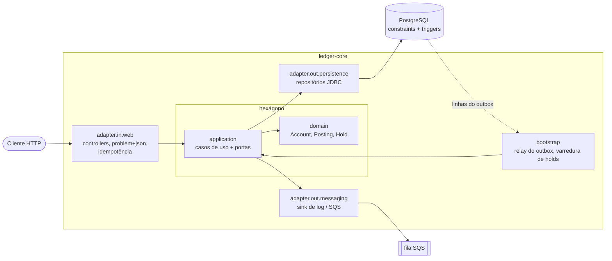

# ledger-core

[English](README.md) | **Português (Brasil)**

[](https://github.com/FrancisWorld/ledger-core/actions/workflows/ci.yml)
[](LICENSE)

API de livro-razão contábil de partidas dobradas em Java 21 e Spring Boot. O dinheiro só se move por lançamentos balanceados, e as regras que mantêm a contabilidade honesta são aplicadas duas vezes: no modelo de domínio e, de novo, dentro do PostgreSQL.

## Por que existe e o que é difícil

Um ledger parece "atualizar dois saldos" até que concorrência, retentativas e falhas aparecem. Este projeto é uma resposta prática aos modos de falha mais comuns:

| Problema | Como é tratado |
| --- | --- |
| Duas requisições gastam o mesmo dinheiro | Linhas travadas com `SELECT ... FOR UPDATE`, sempre em ordem crescente de id da conta: transferências concorrentes se serializam por conta e não geram deadlock. Uma restrição `CHECK` reforça a regra de saldo no banco. |
| Cliente repete uma requisição que deu timeout | `Idempotency-Key` em todo `POST`. A linha da chave e as escritas de negócio confirmam na mesma transação, então a repetição devolve a resposta guardada e o dinheiro se move uma única vez. Mesma chave com corpo diferente é `409`. |
| Alguém altera o histórico | `entries` e `transactions` são append-only (triggers rejeitam `UPDATE`, `DELETE` e `TRUNCATE`) e um constraint trigger adiado impede o commit de uma transação cujos débitos e créditos difiram por moeda. |
| Publicar um evento e gravar o dado podem divergir | Outbox transacional: eventos são gravados na mesma transação da mudança e retransmitidos com `FOR UPDATE SKIP LOCKED`, com entrega ao-menos-uma-vez. |
| Autorizações estilo cartão | Holds reservam fundos (`disponível = saldo - retido`), podem ser capturados (total ou parcialmente) ou liberados, e expiram sozinhos. |
| Erros operacionais | Estornos lançam uma nova transação espelhada; uma transação só pode ser estornada uma vez, garantido por índice único no banco. |

Valores são inteiros em unidades menores da moeda mais um código ISO 4217. Não há float nem decimal em lugar nenhum.

## Arquitetura



`domain` e `application` são Java puro, sem imports de framework. As regras do ArchUnit em `ArchitectureTest` quebram o build se uma dependência apontar para o lado errado (por exemplo a aplicação importar Spring ou JDBC, ou a camada web tocar em SQL).

## Início rápido

Requisitos: JDK 21 e Docker (para o PostgreSQL).

```bash
cp .env.example .env                  # senha de exemplo, edite se quiser
docker compose up --build -d          # PostgreSQL + o serviço em http://localhost:8080
```

Crie três contas (`cash` é um ativo que pode ficar negativo, as carteiras são passivos), financie a Alice e transfira. Esta é a saída real de uma execução local (JAR contra PostgreSQL 16); os ids são UUIDv7:

```text
$ curl -si -X POST /v1/transfers -H "Idempotency-Key: demo-1" -d {alice -> bob, 2500 USD}
HTTP/1.1 201 
Content-Type: application/json
{
  "id": "01a21533-afeb-72f9-81aa-dfbbb0766754",
  "kind": "TRANSFER",
  "reference": null,
  "description": null,
  "reverses_id": null,
  "hold_id": null,
  "created_at": "2026-11-26T00:13:58.635886Z",
  "entries": [
    {
      "account_id": "01a21533-af6a-727f-817e-02fd718ffcc3",
      "direction": "DEBIT",
      "amount": 2500,
      "currency": "USD",
      "balance_after": 7500
    },
    {
      "account_id": "01a21533-af8d-74b6-80ad-a948e316a1c6",
      "direction": "CREDIT",
      "amount": 2500,
      "currency": "USD",
      "balance_after": 2500
    }
  ]
}

$ same request again: replayed, money moves once
HTTP/1.1 201 
Idempotent-Replayed: true

$ same key, different amount
{
    "detail": "Idempotency-Key was already used with a different request",
    "status": 409,
    "title": "idempotency key reuse",
    "type": "urn:ledger-core:problem:idempotency-key-reuse",
    "code": "idempotency-key-reuse"
}

$ overspend
{
    "detail": "Account alice would be left with -92499 available, which is not allowed",
    "status": 422,
    "title": "insufficient funds",
    "type": "urn:ledger-core:problem:insufficient-funds",
    "code": "insufficient-funds"
}

$ GET /v1/trial-balance
{
    "balanced": true,
    "currencies": [
        {
            "currency": "USD",
            "debit_normal_total": 10000,
            "credit_normal_total": 10000,
            "drifted_accounts": 0,
            "balanced": true
        }
    ]
}
```

O Swagger UI fica em `/swagger-ui`, o documento OpenAPI em `/v3/api-docs`, a saúde em `/actuator/health` e as métricas Prometheus em `/actuator/prometheus`.

Para rodar a partir do código contra o banco do compose:

```bash
docker compose up -d postgres
LEDGER_DB_PASSWORD=replace-me ./mvnw spring-boot:run
```

## Decisões de projeto e trade-offs

- **Lock pessimista em vez de retentativas otimistas.** A linha da conta é o ponto de contenção, e um ledger nunca deve rejeitar uma transferência válida só porque outra pessoa tocou na conta. Os locks seguem uma ordem total (id crescente), o que torna o desenho livre de deadlock, e uma transação toca no máximo 100 contas. O custo é que uma conta muito quente serializa seus escritores; veja Limitações.
- **O saldo é avaliado no estado final do lançamento**, não linha a linha, então a ordem das linhas dentro da transação é irrelevante. Contas podem optar por `allow_negative` (caixa, tesouraria, contas de compensação).
- **O tipo da conta define o lado normal.** Ativo e despesa crescem com débito; passivo, patrimônio e receita crescem com crédito. Assim a carteira de um cliente é um passivo de natureza credora e `balance` é sempre o número natural, positivo.
- **Cada lançamento guarda `balance_after`.** Extratos não precisam de função de janela, e o endpoint de balancete refaz todos os lançamentos para provar que cada saldo guardado bate com seu histórico.
- **A idempotência vive na mesma transação do trabalho.** Não existe estado "em andamento" que possa ficar preso depois de uma falha. O custo: uma requisição que falha (por exemplo saldo insuficiente) não deixa chave e é simplesmente reavaliada na repetição. A impressão digital é um hash da operação mais a re-serialização canônica do corpo já interpretado, então espaços e ordem dos campos não importam.
- **A entrega do outbox é ao-menos-uma-vez.** Uma falha depois que o broker aceitou a mensagem e antes do commit do lote reentrega, e os consumidores deduplicam pelo atributo `event_id`. Mensagens que falham repetidamente recuam exponencialmente e por fim são estacionadas como `DEAD`, em vez de travar a fila.
- **Holds** são restritos a contas de natureza credora (carteiras). Uma captura dissolve a reserva inteira: a parte capturada vira débito e o resto fica livre de novo.
- **JDBC puro (`JdbcClient`) em vez de JPA.** O comportamento interessante é o SQL, então ele é escrito e testado como SQL.
- **Identificadores UUIDv7** mantêm as inserções de chave primária aproximadamente ordenadas no tempo.

## Estratégia de testes

`./mvnw verify` roda tudo. Os testes de integração sobem o PostgreSQL 16 com Testcontainers.

| Camada | O que prova |
| --- | --- |
| Testes unitários do domínio | Lados normais, aritmética de saldo, overflow, máquina de estados do hold, validação do lançamento. |
| Propriedades (jqwik) | Em mundos e lançamentos aleatórios: a equação contábil sempre vale, lançamentos aceitos nunca deixam uma carteira negativa, a ordem das linhas não muda o resultado, um estorno restaura todos os saldos, os saldos correntes batem com o estado final. |
| `DatabaseInvariantsIT` | SQL cru que ignora a aplicação: lançamentos desbalanceados falham no commit, o histórico não pode ser alterado, apagado ou truncado, contas não ficam negativas, lançamentos devem usar a moeda da conta. |
| `LedgerApiIT` | Comportamento HTTP de ponta a ponta, formatos `application/problem+json`, extratos e paginação, holds, estornos, OpenAPI e métricas. |
| `IdempotencyIT` | Repetições, conflito por reuso de chave, impressão digital canônica, nova tentativa após falha e 24 duplicatas concorrentes executando exatamente uma vez. |
| `ConcurrencyIT` | Carga mista de transferência / hold / captura / liberação / estorno vinda de várias threads, seguida de auditoria: o dinheiro se conserva, nada fica negativo, o retido é igual aos holds ativos, a cadeia de saldos correntes de cada conta está íntegra e o balancete fecha. Também transferências opostas (sem deadlock), gasto e holds disputados (nunca negativo) e estornos concorrentes (exatamente um vence). |
| `OutboxIT` | Eventos confirmam atomicamente com sua mudança, quatro relays concorrentes entregam cada mensagem uma vez, uma falha simulada após a entrega reentrega em vez de perder, mensagens venenosas recuam e são estacionadas. |
| `ArchitectureTest` | As regras de dependência hexagonais. |

Uma carga de correção, não um benchmark: o `ConcurrencyIT` roda 24 threads x 120 operações mistas (transferências, holds, capturas, liberações, estornos) sobre 12 carteiras; na minha última execução 2426 operações tiveram sucesso e 454 foram rejeitadas legitimamente (saldo insuficiente, hold já liquidado, já estornado), em cerca de 5,4 s, e depois todas as auditorias de invariantes passaram. Medido em um laptop Apple Silicon (M1, 8 GB) com PostgreSQL em uma VM Colima com `fsync=off`; o número não diz nada sobre capacidade de produção.

Para rodar os testes de integração sem Testcontainers, aponte-os para qualquer PostgreSQL 16 (por exemplo o do compose) com `LEDGER_TEST_DB_URL`, `LEDGER_TEST_DB_USER` e `LEDGER_TEST_DB_PASSWORD`. No Colima, o Testcontainers precisa de `DOCKER_HOST=unix://$HOME/.colima/default/docker.sock` e `TESTCONTAINERS_DOCKER_SOCKET_OVERRIDE=/var/run/docker.sock`.

O estilo de código é verificado pelo Spotless (google-java-format) e pelo Checkstyle, ambos ligados à fase `validate`; rode `./mvnw spotless:apply` para formatar. O compilador roda com `-Xlint:all -Werror`.

## Infraestrutura

`infra/` contém uma configuração OpenTofu para a AWS: VPC com sub-redes públicas e privadas, Application Load Balancer, serviço ECS Fargate com autoscaling, RDS PostgreSQL (credenciais geradas e guardadas pelo próprio RDS no Secrets Manager, nunca no state nem na configuração), fila SQS com dead-letter queue para o relay do outbox, ECR e IAM de menor privilégio (a role de execução só puxa esta imagem, escreve neste log group e lê este segredo; a role da tarefa só pode fazer `sqs:SendMessage` na fila de eventos).

Ela é apenas validada, nunca aplicada:

```bash
cd infra && tofu fmt -check && tofu init -backend=false && tofu validate
```

## Limitações

- Sem autenticação nem autorização; o serviço deve ficar atrás de um gateway ou service mesh que as ofereça.
- Uma única conta quente serializa seus escritores (lock de linha por conta). Não há sharding nem agrupamento de lançamentos.
- As chaves de idempotência são guardadas para sempre; não há rotina de expurgo por TTL.
- Só a resposta final de uma requisição bem-sucedida é guardada; requisições que falham são reexecutadas.
- A ordem do outbox é a de inserção, não garantida entre relays concorrentes, e a entrega é ao-menos-uma-vez.
- Banco único, sem particionamento de `entries`; o diário append-only cresce sem limite.
- Transferências entre moedas só são possíveis como lançamentos explícitos de várias linhas por contas de compensação; não há motor de câmbio.
- Apenas o Dockerfile e a configuração OpenTofu foram validados (build e `tofu validate`); a stack AWS nunca foi aplicada.

## Licença

[MIT](LICENSE)

---

Built by [Chico Oliveira](https://github.com/FrancisWorld)
